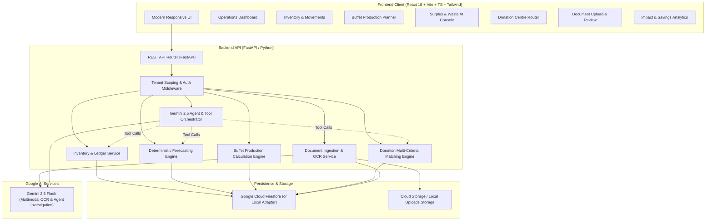
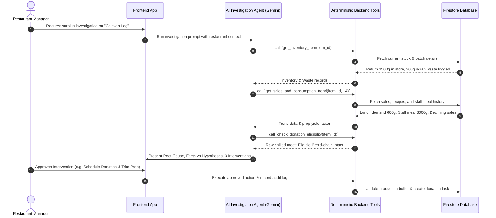

# System Architecture: Food Waste Management and Inventory Optimization

## 1. High-Level Architecture Overview

The system is engineered as a decoupled, full-stack enterprise web application optimized for high reliability, strict tenant isolation, and clear separation between deterministic business computation and Generative AI reasoning.

---

## 2. Component Breakdown

### 2.1 Frontend Architecture (`/frontend`)
- **Framework**: React 18, TypeScript, Vite.
- **Styling**: Tailwind CSS with custom restaurant design system (emerald/amber/slate palette for food ops).
- **Icons**: Lucide React.
- **Visualizations**: Recharts for demand trends, waste breakdown, and variance charts.
- **State & Data Fetching**: Standard React custom hooks (`useInventory`, `useForecast`, `useAgentInvestigation`, `useDonations`) with optimistic updates and robust error boundaries.
- **Key Modules**:
  1. `DashboardView`: Real-time stock alerts, today's buffet plan summary, pending waste interventions, donation matches.
  2. `InventoryView`: Searchable table with stock levels, batch/expiry alerts, manual adjustments, and historical stock movements.
  3. `DocumentUploadView`: Drag-and-drop file upload for handwritten forms, invoice PDFs, and Excel sheets with an interactive review table before database commit.
  4. `BuffetPlanningView`: Service-specific production planner with cover projections, batch sizing, and ingredient pull lists.
  5. `SurplusInvestigationView`: AI Agent workspace displaying root-cause diagnostics, evidence logs, intervention options, and manager approval buttons.
  6. `DonationDirectoryView`: Verified charity directory, criteria filters, and live matching modal with pickup fee transparency.
  7. `ImpactAnalyticsView`: Operational financial savings, food waste diverted from landfill, and forecast accuracy metrics.

### 2.2 Backend Architecture (`/backend`)
- **Framework**: FastAPI (Python 3.11+).
- **API Design**: OpenAPI / Swagger compliant REST endpoints with strict Pydantic v2 data models.
- **Architecture Pattern**: Clean Architecture with Service-Repository pattern:
  - `routers/`: HTTP transport layer, request validation, response serialization.
  - `services/`: Core business logic, stock ledger transactions, math calculations.
  - `engines/`: Pure deterministic mathematical engines (forecasting, EOQ, buffet batching, charity distance/criteria matching).
  - `agents/`: Gemini-powered agents, prompt templates, structured tool declarations.
  - `repositories/`: Database abstraction layer (Firestore client with transparent local filesystem fallback).
  - `schemas/`: Pydantic request, response, and domain models.

### 2.3 AI Agent & Tool Calling Architecture
The AI layer never performs direct unvalidated database writes or loose math. It operates in an agentic loop:

---

## 3. Storage and Database Strategy
- **Primary Database**: Google Cloud Firestore.
  - Document paths structured under `/restaurants/{restaurant_id}/{collection_name}/{doc_id}` to guarantee absolute tenant isolation.
- **Local Fallback Adapter**: When developing without GCP credentials or offline, the repository automatically utilizes a JSON-backed Local Firestore Repository that replicates Firestore query semantics (`where`, `order_by`, `limit`, collection-group).
- **File Storage**: Uploaded scanned forms (Taiken Wastage, Staff Meals, Stock Count) are saved in `/uploads/restaurants/{restaurant_id}/` (or Google Cloud Storage bucket in production) with cryptographic SHA-256 hash checking to prevent duplicate imports.
